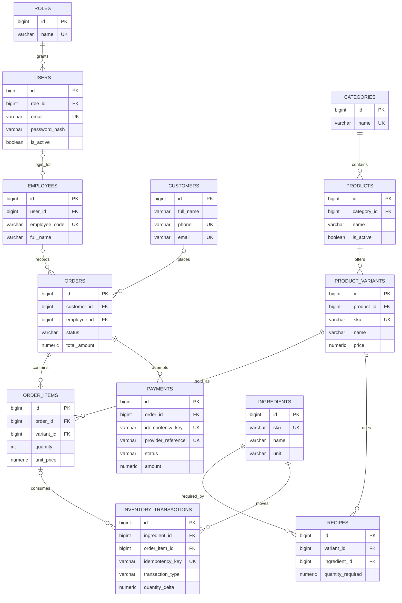

# Task 2 — Database design

## Phạm vi và giả định MVP

Quán quản lý nhân viên, khách hàng, menu theo biến thể (ví dụ size), đơn hàng, thanh toán, công thức pha chế và biến động nguyên liệu. Một `User` có một `Role`; `Employee` có thể gắn với một `User` để đăng nhập. Khách mua tại quầy có thể không có hồ sơ nên `Orders.customer_id` được phép null. Nhân viên tạo đơn cũng tùy chọn để sau này hỗ trợ kênh tự phục vụ. Một đơn MVP có tối đa một lần thanh toán **thành công**; những lần thử thất bại hoặc pending vẫn được ghi lại. Chưa hỗ trợ thanh toán từng phần.

## ERD

`PK` là khóa chính `BIGINT GENERATED BY DEFAULT AS IDENTITY`, xác định duy nhất một dòng. `FK` buộc dòng con tham chiếu dòng cha có thật; PostgreSQL không tự tạo index cho FK nên các FK truy vấn thường xuyên có index riêng. `UK` là unique constraint; PostgreSQL tạo index hỗ trợ cho constraint này. Ngoài ra có unique ghép `(product_id, name)` và `(variant_id, ingredient_id)` để tránh biến thể hoặc nguyên liệu công thức lặp trong cùng phạm vi.

## Ràng buộc quan trọng

- `price`, `unit_price`, `total_amount`, `amount` dùng `NUMERIC(12,2)` và Python `Decimal`. `quantity_required`, `quantity_delta` dùng `NUMERIC(14,3)`. Không dùng `float` cho tiền.
- `OrderItems.unit_price` là ảnh chụp giá bán khi đặt hàng. Đổi `ProductVariants.price` không đổi lịch sử đơn. `Orders.total_amount` là tổng đã chốt, có thể khác tổng dòng hàng khi có giảm giá ở task sau; logic tạo đơn phải tính và lưu nhất quán trong một transaction.
- Check constraint ngăn giá/tổng âm, số lượng dòng hàng không dương, định mức công thức không dương, biến động kho bằng 0, hướng nhập/xuất kho sai dấu và giá trị trạng thái ngoài danh sách.
- `Payments.idempotency_key` và `InventoryTransactions.idempotency_key` unique để retry cùng sự kiện không ghi thêm dòng. `provider_reference` unique khi có giá trị. Partial unique index trên `Payments(order_id)` khi `status = 'succeeded'` chặn hai payment thành công cho một đơn.
- Partial unique index trên `InventoryTransactions(order_item_id, ingredient_id)` khi `transaction_type = 'sale'` chặn xuất cùng nguyên liệu hai lần cho một dòng đơn. Giao dịch `sale` bắt buộc có `order_item_id`.
- FK không có cascade delete. Giữ lịch sử đơn, thanh toán và kho; vô hiệu hóa menu hoặc nhân viên bằng `is_active` thay vì xóa dòng được tham chiếu.

## Chuẩn hóa và mở rộng

Danh mục, sản phẩm, biến thể, nguyên liệu và công thức nằm ở bảng riêng; quan hệ nhiều-nhiều giữa biến thể và nguyên liệu đi qua `Recipes`. Dữ liệu giá bán lịch sử và tổng đơn là ngoại lệ có chủ đích vì là giá đã chốt tại thời điểm giao dịch. Không lưu `current_stock`: tính `SUM(quantity_delta)` theo ingredient để tránh hai nguồn sự thật. Nếu dữ liệu lớn, có thể thêm bảng số dư/cache cập nhật trong cùng transaction và đối soát với ledger; chưa cần ở MVP.

Email/điện thoại và SKU hiện unique theo giá trị lưu trong DB. Tầng nhập liệu sau này cần chuẩn hóa chữ hoa/thường và định dạng điện thoại trước khi ghi. Đơn giá dùng 2 chữ số thập phân; nếu kinh doanh bằng VND nguyên đồng, tầng nghiệp vụ quyết định quy tắc làm tròn. Trạng thái hiện dùng CHECK thay vì PostgreSQL ENUM để thay đổi dễ hơn qua migration.

## Transaction và chống trùng lặp

Ở task nghiệp vụ sau này, đặt hàng và xuất kho phải thực hiện trong **một** `with session.begin()`; khóa các dòng `Ingredients` liên quan bằng `SELECT ... FOR UPDATE` theo thứ tự `id`, tính số dư, kiểm tra đủ kho, rồi ghi `InventoryTransactions`. Nếu bất kỳ bước nào lỗi thì rollback toàn bộ. Khóa dòng ingredient tuần tự hóa hai đơn cùng dùng nguyên liệu; unique index chặn replay cùng order item. Payment handler cần dùng khóa idempotency ổn định từ request/nhà cung cấp, ghi payment trong transaction và xử lý unique violation như kết quả retry. Chỉ kiểm tra tồn bằng `SELECT SUM(...)` mà không khóa sẽ không chống được oversell đồng thời.

Các protocol này được **thiết kế**, chưa triển khai thành nghiệp vụ/API ở Task 2. Database constraint chặn bản ghi trùng nhưng chưa tự bảo đảm số dư không âm hoặc `Payments.amount = Orders.total_amount`; các điều kiện này thuộc thao tác nghiệp vụ trong transaction và cần test đồng thời khi triển khai.

## Migration và an toàn

Revision đầu tiên là `d8398c7e85ca`. Alembic lấy URL từ biến môi trường `DATABASE_URL`, không lưu credential trong `alembic.ini`. Chỉ chạy `upgrade head` sau khi kiểm tra URL và backup nếu database có dữ liệu. Không chạy `downgrade` trên database có dữ liệu. Test PostgreSQL dùng `TEST_DATABASE_URL` với tên database kết thúc bằng `_test`, và mỗi test rollback dữ liệu của mình.
