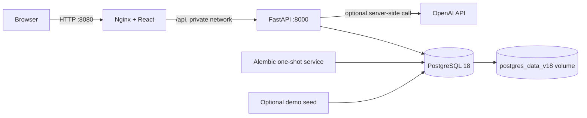

# Docker and deployment

## Architecture



Nginx serves the compiled SPA and proxies `/api/*` to FastAPI. PostgreSQL is not published to the host. FastAPI is bound to host loopback for local API/docs access. `migrate` must exit successfully before the backend starts, and the frontend waits for backend health.

PostgreSQL 18 stores its versioned data directory below `/var/lib/postgresql`, so Compose mounts the persistent `postgres_data_v18` volume at that parent path. Keep the volume name and mount point unchanged during normal upgrades.

## Images

The backend uses a two-stage `python:3.14-slim` build. Dependencies are built as wheels; the runtime contains no compiler or source checkout and runs as an unprivileged `app` user. The image contains Alembic scripts because migration is a separate command using the same immutable artifact.

The frontend uses `node:24-alpine` with `npm ci`, produces static files, then copies only `dist/` into `nginxinc/nginx-unprivileged`. Nginx runs on port 8080 and sets CSP and common browser security headers.

## Development with Docker Compose

Docker Desktop with Compose v2 is required. Copy the template and replace every `CHANGE_ME` value:

```powershell
Copy-Item docker.env.example .env.docker
python -c "import secrets; print(secrets.token_urlsafe(32))"
python -c "import secrets; print(secrets.token_urlsafe(48))"
```

Use the first random value for `POSTGRES_PASSWORD` and its URL-encoded equivalent inside `DATABASE_URL`. Use the second for `JWT_SECRET_KEY`. `.env.docker` is ignored by Git.

Validate and start:

```powershell
docker compose --env-file .env.docker config --quiet
docker compose --env-file .env.docker build
docker compose --env-file .env.docker up -d
docker compose --env-file .env.docker ps
```

Open:

- UI: `http://localhost:8080`
- API health: `http://127.0.0.1:8000/health`
- API docs: `http://127.0.0.1:8000/docs`

Inspect startup without printing the environment:

```powershell
docker compose --env-file .env.docker logs migrate backend frontend
```

Stop containers while retaining PostgreSQL data:

```powershell
docker compose --env-file .env.docker down
```

Never add `-v` unless permanent deletion of the database volume is explicitly intended and an approved backup exists.

### Persistence check

Create a product in the UI, then restart only PostgreSQL:

```powershell
docker compose --env-file .env.docker restart db
docker compose --env-file .env.docker up -d --wait backend frontend
```

The product must remain visible. CI performs the same class of check using demo records before and after a database container restart.

## Safe migrations

Each release follows this sequence:

1. Review every new Alembic revision and confirm whether it is backward compatible.
2. Create and verify a database backup.
3. Build one immutable backend image.
4. Run that image once with `python -m alembic upgrade head`.
5. Verify `python -m alembic current` reports the expected revision.
6. Start the backend only after migration succeeds.
7. Run health and business smoke tests.

Compose encodes this as `db healthy -> migrate completed -> backend healthy -> frontend`. Never run multiple migration replicas. Do not automatically downgrade a database containing production data.

Manual migration commands:

```powershell
docker compose --env-file .env.docker run --rm migrate
docker compose --env-file .env.docker run --rm backend python -m alembic current
```

## Safe demo data

Demo seeding is opt-in, idempotent, refuses `APP_ENV=production`, and uses `demo.admin@example.com`. It creates one fake product with three variants and three fake ingredients. It never overwrites an existing demo password.

Set a unique password of at least 12 characters, then run:

```powershell
docker compose --env-file .env.docker --profile demo run --rm demo-seed
```

Login with `demo.admin@example.com` and the value of `DEMO_ADMIN_PASSWORD`. Do not reuse this account or password outside an isolated demo environment.

## Backup

Create the host backup directory and generate a PostgreSQL custom-format dump inside the container:

```powershell
New-Item -ItemType Directory -Force backups | Out-Null
$stamp = Get-Date -Format "yyyyMMdd-HHmmss"
docker compose --env-file .env.docker exec -T db sh -c 'pg_dump -U "$POSTGRES_USER" -d "$POSTGRES_DB" -Fc -f /tmp/coffee.backup'
docker compose --env-file .env.docker cp db:/tmp/coffee.backup "backups/coffee-$stamp.backup"
docker compose --env-file .env.docker exec -T db rm -f /tmp/coffee.backup
```

Store backups encrypted outside the Docker host. Record the application version and Alembic revision with each backup. Periodically test restoration.

## Restore without overwriting the active database

Restore first into a new database and validate it:

```powershell
docker compose --env-file .env.docker cp backups/coffee-YYYYMMDD-HHMMSS.backup db:/tmp/restore.backup
docker compose --env-file .env.docker exec -T db sh -c 'createdb -U "$POSTGRES_USER" coffee_shop_restore'
docker compose --env-file .env.docker exec -T db sh -c 'pg_restore -U "$POSTGRES_USER" -d coffee_shop_restore --no-owner --no-privileges /tmp/restore.backup'
docker compose --env-file .env.docker exec -T db sh -c 'psql -U "$POSTGRES_USER" -d coffee_shop_restore -c "SELECT version_num FROM alembic_version;"'
```

Point a temporary backend at `coffee_shop_restore`, run read-only smoke checks, and only then plan a controlled switch. These commands do not delete or overwrite the active `coffee_shop` database.

## Production recommendation

Use a managed container platform plus managed PostgreSQL for production. Examples include ECS/Fargate with RDS, Cloud Run with Cloud SQL, or an equivalent regional provider.

Advantages:

- managed TLS/load balancer, secret storage, database backups, monitoring, and replacement of unhealthy containers;
- immutable image releases and simple application rollback;
- PostgreSQL maintenance and point-in-time recovery are handled by the database service.

Tradeoffs:

- higher cost and platform-specific networking/IAM;
- migrations and connection limits still require deliberate release controls;
- current process-local login/AI rate limits require a shared gateway or Redis before multiple replicas are enabled.

Docker Compose is appropriate for development, demos, and a small single-host staging environment. It does not provide high availability or managed failover.

### Production configuration

- Terminate HTTPS at the platform load balancer or a reviewed reverse proxy. Redirect HTTP to HTTPS and enable HSTS only after HTTPS is verified.
- Keep frontend and API same-origin where possible. Set `CORS_ALLOWED_ORIGINS` to exact HTTPS origins when cross-origin access is required.
- Store `DATABASE_URL`, `JWT_SECRET_KEY`, `OPENAI_API_KEY`, and database passwords in the platform secret manager. Do not bake them into images or image build arguments.
- Send container logs to stdout/stderr and configure centralized retention, redaction, alerts, and request correlation. Do not log prompts, tokens, passwords, customer contact data, or tool results.
- Use a connection pool/proxy sized for the managed database. Keep PostgreSQL private.
- Use immutable image digests, vulnerability scanning, least-privilege service identities, read-only filesystems where supported, CPU/memory limits, and rolling health checks.
- Replace process-local rate limits with a gateway or shared store before scaling beyond one backend replica.

## Rollback plan

1. Stop promotion when migration, health, or smoke checks fail.
2. Preserve logs and the pre-migration backup; do not delete the database volume.
3. If the migration is backward compatible, redeploy the previous immutable backend/frontend image and keep the upgraded schema.
4. If the migration is incompatible, block writes, restore the pre-migration backup into a new database, validate it, switch `DATABASE_URL`, then deploy the previous images.
5. Verify login, product reads, one isolated order/payment flow, inventory balance, reports, and AI configuration.
6. Record the incident and reconcile any writes accepted between backup and write freeze.

Alembic `downgrade` is not the default rollback method because data transformations may be irreversible.

## Local verification evidence

Verified on 2026-10-20 with Docker Desktop 4.95.0, Docker Engine 29.8.2, and Compose 5.6.0:

- backend, frontend, migration, and demo seed images built successfully;
- Alembic migrated a fresh PostgreSQL 18 volume to `b9d1e3f5a7c2`;
- all long-running services became healthy;
- smoke tests passed through FastAPI directly and through the Nginx `/api` proxy;
- order and payment retries returned the original records;
- the AI endpoint returned the validated `ai_not_configured` response because no server-side key was supplied;
- a custom-format backup restored into an isolated database;
- PostgreSQL restart retained demo products, inventory, transactions, and login data.

## Demo acceptance checklist

- [x] `migrate` exits with code 0 and reports the expected head revision.
- [x] `db`, `backend`, and `frontend` are healthy.
- [x] UI loads through Nginx and `/api` reaches FastAPI.
- [x] Demo Admin can log in.
- [x] Product list contains `DEMO-LATTE-S/M/L`.
- [x] Create, place, and pay an order; retrying the same idempotency key does not duplicate it.
- [x] Inventory list shows fake opening balances.
- [x] Revenue dashboard includes the paid demo order.
- [x] AI chat returns the documented configuration error without a server-side key; provider behavior remains covered by mocked automated tests.
- [x] Restarting `db` preserves products and transactions.
- [x] Backup can be restored into a separate validation database.
- [x] No `.env.docker`, credentials, tokens, or customer data are tracked by Git.

Production deployment remains **NOT DONE** until an authorized environment is deployed and these checks are repeated there.
