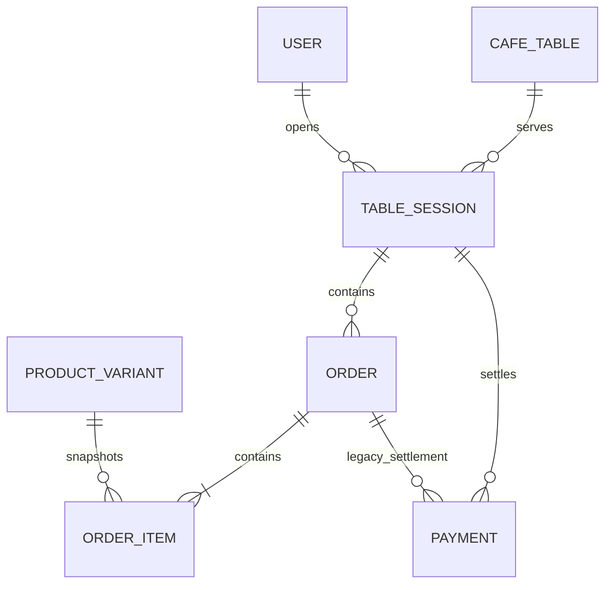

# Table sessions, menu, and additional orders

Task 13 extends the existing order model without rewriting historical standalone orders.
`orders.session_id` is nullable, so pre-migration rows keep their original workflow and
APIs. New dine-in orders belong to a table session and use `draft`, `confirmed`, and
`cancelled` states.

## API

- `GET/POST /tables`, `GET/PATCH /tables/{id}` list and manage tables. Writes require
  Admin or Manager; all authenticated shop roles can read.
- `POST /tables/{id}/sessions` opens a session and its empty initial draft atomically.
- `GET /tables/{id}/active-session` and `GET /sessions/{id}` return persisted history
  plus confirmed, draft, and payable totals.
- `POST /sessions/{id}/orders` with `{ "order_type": "additional" }` creates the next
  additional draft after the initial order is confirmed.
- `POST /orders/{id}/items`, `PATCH/DELETE /orders/{id}/items/{item_id}` mutate only
  drafts. Prices and totals are calculated from locked catalog rows by the backend.
- `POST /orders/{id}/confirm` confirms a non-empty draft and consumes inventory in the
  same transaction.
- `POST /sessions/{id}/checkout` requires `Idempotency-Key`, rejects non-empty drafts,
  records one session payment, and releases the table only after successful payment.
- `GET /sessions/{id}/bill` returns `confirmed_subtotal`, `draft_subtotal`, and
  `payable_total`; draft and cancelled orders never contribute to payable total.

## Concurrency and integrity

PostgreSQL partial unique indexes permit only one open session per table, one additional
draft per session, and one successful session payment. `(session_id, sequence_number)` is
unique. Services lock the table/session/order before state changes; confirmation and
checkout each use one transaction. Item snapshots preserve the confirmed price even if
the menu price later changes.

## Manual workflow

1. Apply the reviewed migration to a backed-up development database with
   `python -m alembic upgrade head`.
2. Start the API and frontend as described in the root README.
3. Sign in as Admin/Manager, open **Bàn & đơn hàng**, and create a table.
4. Open its session, choose the table in **Menu**, and add products.
5. Return to the table, adjust quantities, and confirm the initial order.
6. Use **Add Additional Order**, add another product from Menu, and confirm it.
7. Verify draft is excluded from payable total, then checkout. The table becomes
   available while the session, orders, snapshots, and payment remain stored.

Do not run downgrade against a database containing business data; reversal requires an
explicit data migration.

## Task 13 V3 pricing and checkout

Products now own a Decimal `base_price`. Existing `product_variants` are treated as
sizes and their `price` is the upsize amount. Toppings are product-scoped. The migration
preserves the old final menu price by moving the lowest historical variant price into
`products.base_price` and subtracting it from each size price.

The backend computes `base price + size extra + topping prices`; each order item stores
the resulting unit price plus immutable product, size, SKU, and topping snapshots.

Checkout supports `cash` and `bank_transfer`. Cash persists amount received and exact
change while revenue remains the bill amount. Bank transfer details come only from
`PAYMENT_BANK_*` server environment variables. The displayed QR is a VietQR Quick Link
with the bill amount and session reference; staff must explicitly verify receipt before
confirmation.

Successful checkout creates one payment and receipt, records the cashier and paid time,
and closes the session in one transaction. Table availability and current total are
derived from the absence of an open session. No order, item, payment, or session is
deleted or zeroed. Receipts remain available through `GET /receipts` and
`GET /receipts/{receipt_number}`.

Revenue reports aggregate successful payment records, including legacy order payments
and consolidated session payments. `cash_received` is never counted as revenue.
